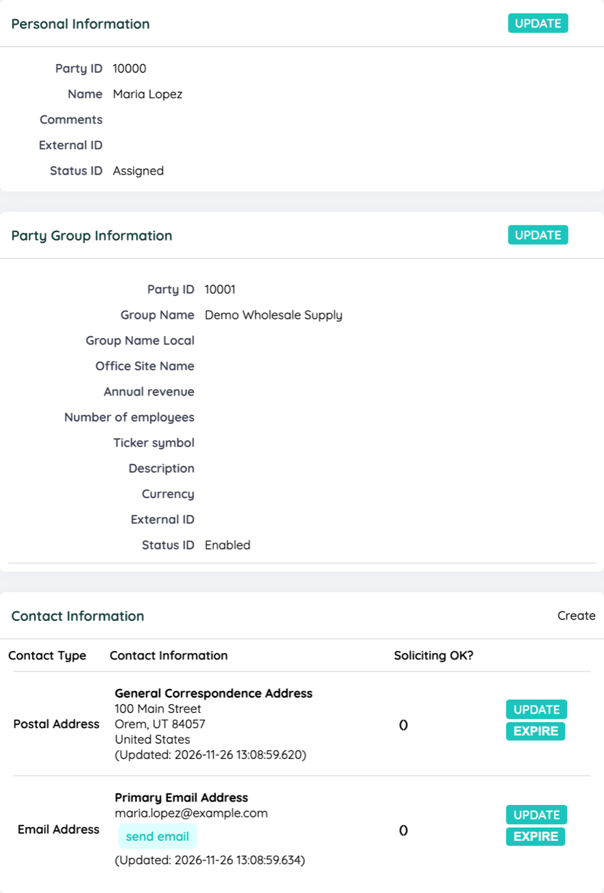
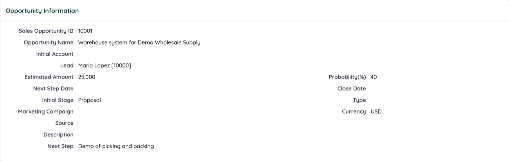

Apache OFBiz helps a sales team track leads, contacts and sales opportunities, from the first call to the order. Its CRM shares one database with orders, so a won deal becomes an order in the same system. It is free and open source under the Apache License 2.0.

<h2 id="Crm1">Who it is for</h2>

<ul class="iconsList">
  <li><i class="icon-pin"></i> Sales teams that sell to businesses and follow each deal through stages.</li>
  <li><i class="icon-pin"></i> Businesses that want customer records, orders and invoices in one system.</li>
  <li><i class="icon-pin"></i> Marketing teams that send campaigns to lists of contacts.</li>
</ul>

<h2 id="Crm2">What OFBiz does for sales and marketing</h2>

<h3>Leads</h3>

Add a lead in a few seconds with the quick add form, or enter the full details with the company, address and email. You can also create a lead from a vCard, and merge two leads that are the same person.
User manual: <a href="https://nightlies.apache.org/ofbiz/stable/ofbiz/html5/user-manual.html#_sfa_leads_findlist_screen">SFA, Leads</a>

<h3>Turn a lead into a contact and an account</h3>

When a lead becomes real, convert it. OFBiz turns the person into a contact and the company into an account.
User manual: <a href="https://nightlies.apache.org/ofbiz/stable/ofbiz/html5/user-manual.html#_sfa_leads_findlist_screen">SFA, Leads</a>

<h3>Contacts and accounts</h3>

Keep each company as an account, and each person as a contact with addresses, phone numbers and email addresses. A contact can be exported as a vCard.
User manual: <a href="https://nightlies.apache.org/ofbiz/stable/ofbiz/html5/user-manual.html#_sfa_accounts_findlist_screen">SFA, Accounts and Contacts</a>

<h3>Sales opportunities</h3>

Follow each deal with an estimated amount, a probability, a close date and the next step. Move it through stages such as Prospect, Proposal, Quoted and Closed.
User manual: <a href="https://nightlies.apache.org/ofbiz/stable/ofbiz/html5/user-manual.html#_sfa_salesopportunity_findlist_screen">SFA, Sales Opportunities</a>

<h3>Sales forecasts</h3>

Set a quota and a forecast amount for each sales period. Compare what the team expects with what it must reach.
User manual: <a href="https://nightlies.apache.org/ofbiz/stable/ofbiz/html5/user-manual.html#_sfa">SFA</a>

<h3>Calls, emails and meetings</h3>

Log each call, email and meeting with a customer as an event, and assign follow-up tasks.
User manual: <a href="https://nightlies.apache.org/ofbiz/stable/ofbiz/html5/user-manual.html#_sfa">SFA</a>

<h3>Marketing campaigns and contact lists</h3>

Plan marketing campaigns, and build contact lists by hand or by importing contacts. Group customers into segments, and use tracking codes to see which campaign brought each visitor.
User manual: <a href="https://nightlies.apache.org/ofbiz/stable/ofbiz/html5/user-manual.html#_marketing_contact_lists">Marketing, Contact Lists</a>

<h3>Customer requests</h3>

Record what a customer asks for, such as a quote, information or support, and follow it until it is answered.
Where: Order &gt; Requests

 A lead with the company, address and email.

 A sales opportunity with amount, probability, stage and next step.

<h2 id="Crm3">How it connects with the rest of OFBiz</h2>

Leads, contacts and accounts are the same customer records that orders and invoices use. When a deal is won, staff enter the order for the same customer. See <a href="/order-management/">Order Management</a>.

<h2 id="Crm4">Try it</h2>

<ul class="iconsList">
  <li><i class="icon-pin"></i> Open the <a href="/ofbiz-demos/">public demo</a> and go to the SFA application. SFA stands for sales force automation.</li>
  <li><i class="icon-pin"></i> <a href="/downloads/">Download Apache OFBiz</a> and run it on your own computer.</li>
  <li><i class="icon-pin"></i> Read the <a href="https://nightlies.apache.org/ofbiz/stable/ofbiz/html5/user-manual.html#_sfa">SFA and Marketing chapters of the OFBiz user manual</a>.</li>
</ul>

<h2 id="Crm5">Questions and answers</h2>

<h3>Is Apache OFBiz free?</h3>

Yes. It is open source under the Apache License 2.0. You can use it, change it and run it at no cost.

<h3>Can I use the CRM on its own?</h3>

Yes, but it is built to work with the rest of OFBiz. Its customer records are the same ones that orders and invoices use.

<h3>Is there a mobile app?</h3>

No. OFBiz runs in a web browser.

<h3>Do I need technical skills to set it up?</h3>

Yes. OFBiz runs on Java, and setup needs some technical work. The <a href="https://cwiki.apache.org/confluence/display/OFBIZ/Apache+OFBiz+Service+Providers">service providers list</a> names people who can help.

<h2 id="Crm6">Get help</h2>

Ask questions on the <a href="/mailing-lists/">user mailing list</a>. See who uses OFBiz on the <a href="https://cwiki.apache.org/confluence/display/OFBIZ/Apache+OFBiz+User+List">user list</a>, and find help on the <a href="https://cwiki.apache.org/confluence/display/OFBIZ/Apache+OFBiz+Service+Providers">service providers list</a>.

