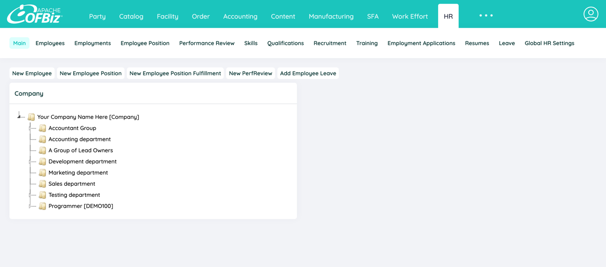
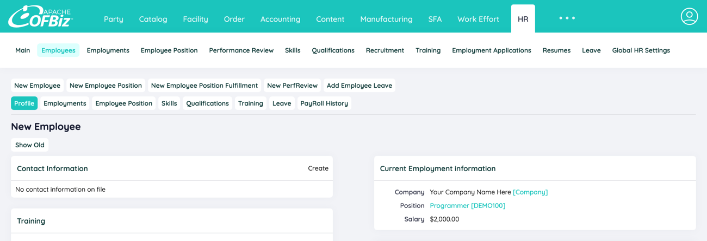

Apache OFBiz includes free HR software for basic staff records. Keep your departments, positions, employees, leave and training next to your orders and accounts. It is open source under the Apache License 2.0.

<h2 id="Hr1">Who it is for</h2>

<ul class="iconsList">
  <li><i class="icon-pin"></i> Small companies that want staff records in the same system as their business.</li>
  <li><i class="icon-pin"></i> Managers who need to see who holds which position and who reports to whom.</li>
  <li><i class="icon-pin"></i> Companies that already use OFBiz and want one place for people data.</li>
</ul>

The HR features are basic. They keep records. They do not run payroll.

<h2 id="Hr2">What OFBiz does for HR</h2>

<h3>Company and department structure</h3>

See your company as a tree of departments on the HR main screen. Add a department under the company, or under another department.
User manual: <a href="https://nightlies.apache.org/ofbiz/stable/ofbiz/html5/user-manual.html#_human_resources">Human Resources, Organization, Job Position and Definition</a>

<h3>Positions and who fills them</h3>

Create a position, such as Programmer, in a department. Then record which employee fills it, from which date. Add the duties of each position and who it reports to.
User manual: <a href="https://nightlies.apache.org/ofbiz/stable/ofbiz/html5/user-manual.html#_human_resources">Human Resources, Employee Positions</a>

<h3>Employee records</h3>

Add a new employee with a name and contact details. The employee profile shows the current company, position and salary in one place.
User manual: <a href="https://nightlies.apache.org/ofbiz/stable/ofbiz/html5/user-manual.html#_human_resources">Human Resources, Employees</a>

<h3>Employment dates and endings</h3>

Record when each employment starts and ends. When someone leaves, record the type, such as resignation or retirement, and the reason.
User manual: <a href="https://nightlies.apache.org/ofbiz/stable/ofbiz/html5/user-manual.html#_human_resources">Human Resources, Employments</a>

<h3>Skills, qualifications and resumes</h3>

Record each person's skills, with years of experience and a rating. Add qualifications, such as degrees and certificates, and keep resumes on file.
User manual: <a href="https://nightlies.apache.org/ofbiz/stable/ofbiz/html5/user-manual.html#_human_resources">Human Resources</a>

<h3>Performance reviews</h3>

Write a performance review for an employee, with a manager and a period. Add review items and ratings, and keep performance notes between reviews.
User manual: <a href="https://nightlies.apache.org/ofbiz/stable/ofbiz/html5/user-manual.html#_human_resources">Human Resources, Performance Management and Employee Evaluation</a>

<h3>Leave</h3>

An employee or manager records a leave, with its type, reason and dates. The approver then approves or rejects it. Keep a list of public holidays as well.
User manual: <a href="https://nightlies.apache.org/ofbiz/stable/ofbiz/html5/user-manual.html#_human_resources">Human Resources, Leave</a>

<h3>Training</h3>

Plan training classes on a calendar. Employees apply for a class, and a manager approves the request.
User manual: <a href="https://nightlies.apache.org/ofbiz/stable/ofbiz/html5/user-manual.html#_human_resources">Human Resources, Training</a>

<h3>Recruitment</h3>

Open a job requisition, which is a request to hire for a position. Post it inside the company, record the applications, and plan interviews. Approve the chosen candidate.
User manual: <a href="https://nightlies.apache.org/ofbiz/stable/ofbiz/html5/user-manual.html#_human_resources">Human Resources, Recruitment</a>

<h3>Salary and benefit records</h3>

Set pay grades and salary steps. Record each employee's pay history, benefits and how they want to be paid. The payroll history lists payroll invoices made in Accounting.
User manual: <a href="https://nightlies.apache.org/ofbiz/stable/ofbiz/html5/user-manual.html#_human_resources">Human Resources, Employee Salary and Benefits Administration</a>

 The HR main screen with the company and its departments as a tree.

 An employee profile with company, position and salary.

<h2 id="Hr3">How it connects with the rest of OFBiz</h2>

Employees are the same people records that the rest of OFBiz uses. So an employee can also log in and do work. Staff record their hours on timesheets in the Work Effort application. Payroll invoices and payments are kept in Accounting. See <a href="/accounting/">Accounting</a>.

<h2 id="Hr4">Try it</h2>

<ul class="iconsList">
  <li><i class="icon-pin"></i> Open the <a href="/ofbiz-demos/">public demo</a> and go to the HR application.</li>
  <li><i class="icon-pin"></i> <a href="/downloads/">Download Apache OFBiz</a> and run it on your own computer.</li>
  <li><i class="icon-pin"></i> Read the <a href="https://nightlies.apache.org/ofbiz/stable/ofbiz/html5/user-manual.html#_human_resources">Human Resources chapter of the OFBiz user manual</a>.</li>
</ul>

<h2 id="Hr5">Questions and answers</h2>

<h3>Is Apache OFBiz free?</h3>

Yes. It is open source under the Apache License 2.0. You can use it, change it and run it at no cost.

<h3>Does OFBiz run payroll?</h3>

No. It does not work out pay, tax or deductions. It keeps salary records, and payroll invoices can be entered in Accounting.

<h3>Does it count leave balances?</h3>

No. It records each leave and its approval. It does not track how many days each person has left.

<h3>Is there a self-service app for employees?</h3>

No. Staff with a login use the same web screens. There is no separate mobile app.

<h3>Do I need technical skills to set it up?</h3>

Yes. OFBiz runs on Java, and setup needs some technical work. The <a href="https://cwiki.apache.org/confluence/display/OFBIZ/Apache+OFBiz+Service+Providers">service providers list</a> names people who can help.

<h2 id="Hr6">Get help</h2>

Ask questions on the <a href="/mailing-lists/">user mailing list</a>. See who uses OFBiz on the <a href="https://cwiki.apache.org/confluence/display/OFBIZ/Apache+OFBiz+User+List">user list</a>, and find help on the <a href="https://cwiki.apache.org/confluence/display/OFBIZ/Apache+OFBiz+Service+Providers">service providers list</a>.

