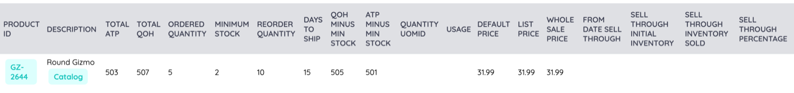
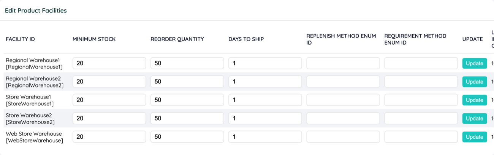
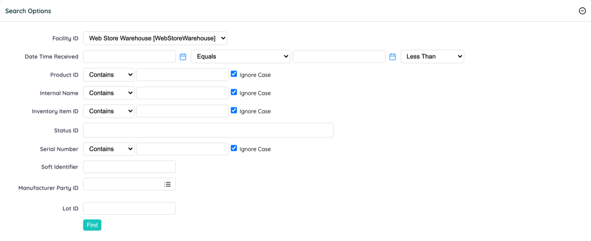
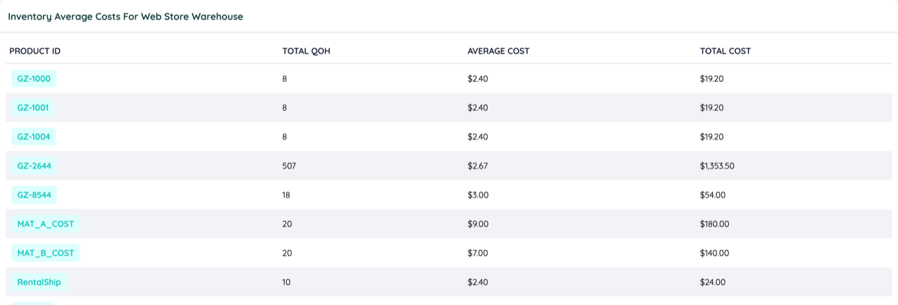

Apache OFBiz shows what stock you have, where it is, and what it is worth. It reserves stock for orders and tells you when to buy more. It is free and open source under the Apache License 2.0.

<h2 id="Inv1">Who it is for</h2>

<ul class="iconsList">
  <li><i class="icon-pin"></i> Owners and buyers who need to know what to sell and when to reorder.</li>
  <li><i class="icon-pin"></i> Businesses with stock in one or more warehouses, such as distributors, manufacturers and online sellers.</li>
  <li><i class="icon-pin"></i> Businesses that track lots, serial numbers or expiry dates, such as food or device sellers.</li>
</ul>

<h2 id="Inv2">What OFBiz does for inventory</h2>

<h3>Stock on hand and stock available</h3>

OFBiz keeps two numbers for every stock item: quantity on hand, the units on the shelf, and available to promise, the units no order has reserved yet. So you always see what you can still sell.
Guide: <a href="https://cwiki.apache.org/confluence/pages/viewpage.action?pageId=467436238">Reserve Stock for Orders in Apache OFBiz</a>

<h3>Stock in several warehouses</h3>

Keep stock in as many warehouses as you need. Each order line shows the stock in its own warehouse and in all warehouses.
Guide: <a href="https://cwiki.apache.org/confluence/pages/viewpage.action?pageId=467436219">Set Up Warehouses and Locations in Apache OFBiz</a>

<h3>Stock reserved for orders</h3>

A sales order reserves stock as soon as it is created. If stock runs short, OFBiz can take the order and mark the rest as backordered.
Guide: <a href="https://cwiki.apache.org/confluence/pages/viewpage.action?pageId=467436238">Reserve Stock for Orders in Apache OFBiz</a>

<h3>Minimum stock and reorder</h3>

Set a minimum stock and a reorder quantity for each product in each warehouse. When stock drops below the minimum, OFBiz creates a request to buy more, which you approve and turn into a purchase order.
Guides: <a href="https://cwiki.apache.org/confluence/pages/viewpage.action?pageId=467436233">Set Minimum Stock and Reorder Quantities in Apache OFBiz</a>, <a href="https://cwiki.apache.org/confluence/pages/viewpage.action?pageId=373886031">Creating Purchase Orders from MRP Recommendations in Apache OFBiz</a>

<h3>Lots, serial numbers and expiry dates</h3>

Give each batch a lot number and an expiry date, or track single units by serial number. OFBiz can reserve the stock that expires first, and show where each lot went.
Guide: <a href="https://cwiki.apache.org/confluence/pages/viewpage.action?pageId=467436235">Track Lots, Serial Numbers and Expiry Dates in Apache OFBiz</a>

<h3>Stock counts and adjustments</h3>

Record the difference between the system and the shelf, with a reason such as Damaged or Lost. OFBiz updates the quantity and the stock value in the books.
Guide: <a href="https://cwiki.apache.org/confluence/pages/viewpage.action?pageId=467436231">Count Stock and Adjust Quantities in Apache OFBiz</a>

<h3>Stock reports and stock value</h3>

See each product's stock on hand, stock available and minimum stock in one list. See the average cost and total value of your stock, and the history of every change.
Guide: <a href="https://cwiki.apache.org/confluence/pages/viewpage.action?pageId=467436293">Read Stock Reports: On Hand, Value and History in Apache OFBiz</a>

<h3>Move stock between warehouses</h3>

Send stock from one warehouse to another when one runs low. Each transfer has a status, such as En-Route or Complete.
Guide: <a href="https://cwiki.apache.org/confluence/pages/viewpage.action?pageId=467436229">Move Stock Between Warehouses in Apache OFBiz</a>

<h3>Dropship from suppliers</h3>

Sell products you do not keep in stock. When you save the sales order, OFBiz creates a purchase order, and the supplier ships straight to your customer.
Guide: <a href="https://cwiki.apache.org/confluence/pages/viewpage.action?pageId=467436306">Ship Directly from the Supplier to the Customer (Dropship) in Apache OFBiz</a>

 Stock on hand, available and minimum stock for each product.

 Minimum stock and reorder quantity for a product in each warehouse.

 Finding stock by lot number.

 Average cost and total value of stock.

<h2 id="Inv3">How it connects with the rest of OFBiz</h2>

Sales orders reserve stock, and purchase orders bring new stock in. Stock counts post to accounting, so stock value in the books matches the shelf. For the daily floor work of receiving, picking and packing, see <a href="/warehouse-management/">Warehouse Management</a>.

<h2 id="Inv4">Try it</h2>

<ul class="iconsList">
  <li><i class="icon-pin"></i> Open the <a href="/ofbiz-demos/">public demo</a> and go to the Facility application.</li>
  <li><i class="icon-pin"></i> <a href="/downloads/">Download Apache OFBiz</a> and run it on your own computer.</li>
  <li><i class="icon-pin"></i> Read all the inventory guides on the wiki: <a href="https://cwiki.apache.org/confluence/pages/viewpage.action?pageId=467436385">Apache OFBiz for Inventory and Warehouse Management</a>.</li>
</ul>

<h2 id="Inv5">Questions and answers</h2>

<h3>Is Apache OFBiz free?</h3>

Yes. It is open source under the Apache License 2.0. You can use it, change it and run it at no cost.

<h3>Can it track stock in several warehouses?</h3>

Yes. Each warehouse has its own stock and its own minimum stock for each product.

<h3>Does it handle expiry dates?</h3>

Yes. Each batch can have an expiry date, and a store can reserve the stock that expires first.

<h3>Does it buy stock for me?</h3>

Not on its own. OFBiz creates a request to buy when stock is low. A person approves it and turns it into a purchase order.

<h3>Do I need technical skills to set it up?</h3>

Yes. OFBiz runs on Java, and setup needs some technical work. The <a href="https://cwiki.apache.org/confluence/display/OFBIZ/Apache+OFBiz+Service+Providers">service providers list</a> names people who can help.

<h2 id="Inv6">Get help</h2>

Ask questions on the <a href="/mailing-lists/">user mailing list</a>. See who uses OFBiz on the <a href="https://cwiki.apache.org/confluence/display/OFBIZ/Apache+OFBiz+User+List">user list</a>, and find help on the <a href="https://cwiki.apache.org/confluence/display/OFBIZ/Apache+OFBiz+Service+Providers">service providers list</a>.

