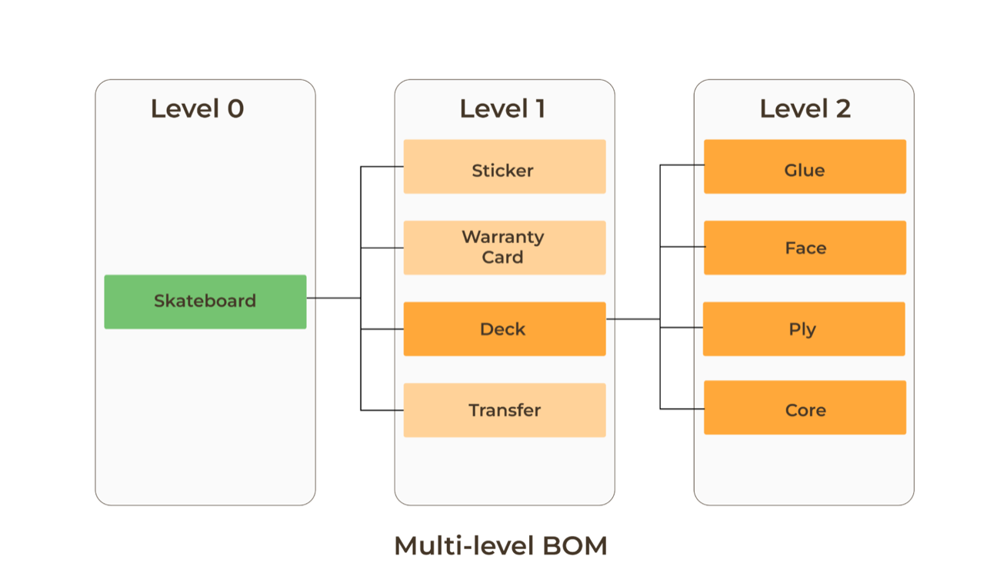
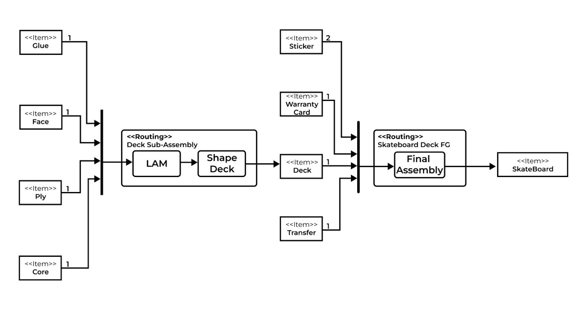
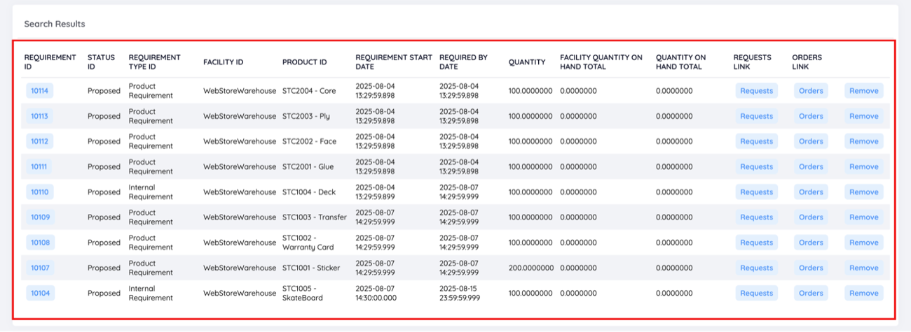

Apache OFBiz plans and runs production: what a product is made of, how it is made, what to buy or make, and what it really costs. It is free and open source under the Apache License 2.0, and it shares one database with orders, purchasing, stock and accounting.

<h2 id="Mfg1">Who it is for</h2>

<ul class="iconsList">
  <li><i class="icon-pin"></i> Small and mid-size manufacturers that make products from parts and raw materials.</li>
  <li><i class="icon-pin"></i> Production planners who need to know what to make, what to buy, and when.</li>
  <li><i class="icon-pin"></i> Businesses that want production, stock and accounting in one system.</li>
</ul>

<h2 id="Mfg2">What OFBiz does for manufacturing</h2>

<h3>Bills of material</h3>

List every part needed to make a product, to any depth. A part can itself be made from other parts.
Guide: <a href="https://cwiki.apache.org/confluence/pages/viewpage.action?pageId=347933410">How to Create a Bill of Materials for a Skateboard in Apache OFBiz in 4 Easy Steps.</a>

<h3>One bill of material for many versions</h3>

Give a product family one bill of material, and let each version, such as a size or a color, use it. This avoids a separate bill of material for every version.
Guides: <a href="https://cwiki.apache.org/confluence/pages/viewpage.action?pageId=358812107">Avoiding Redundant BOMs with Virtual and Variant Product Design in Apache OFBiz</a>, <a href="https://cwiki.apache.org/confluence/pages/viewpage.action?pageId=358812108">Setting Up Variant Products in Apache OFBiz with Virtual Product's BOM: Skateboard Example</a>

<h3>Routings and tasks</h3>

Define the steps that make a product, in order, with the machine and the time for each step.
Guide: <a href="https://cwiki.apache.org/confluence/pages/viewpage.action?pageId=349637112">A practical guide to setup Routing in Apache OFBiz for Manufactures in 4 easy Steps.</a>

<h3>Work calendars</h3>

Plan production around real working hours, shifts, weekends and holidays. Link a calendar to each machine.
Guide: <a href="https://cwiki.apache.org/confluence/pages/viewpage.action?pageId=383191551">Step-by-Step Guide: Apache OFBiz Calendar Function for Production Planning</a>

<h3>MRP: what to make and what to buy</h3>

MRP, material requirements planning, compares demand with stock and planned supply. For every shortfall it proposes to buy the part or to make it.
Guides: <a href="https://cwiki.apache.org/confluence/pages/viewpage.action?pageId=365889942">Understanding Internals of MRP Engine in Apache OFBiz</a>, <a href="https://cwiki.apache.org/confluence/pages/viewpage.action?pageId=372214398">A Practical Walkthrough of MRP Execution in Apache OFBiz</a>

<h3>Production runs from the plan</h3>

When you approve a proposal to make a part, OFBiz creates the production run for it.
Guide: <a href="https://cwiki.apache.org/confluence/pages/viewpage.action?pageId=373886278">Automated Creation of Production Run From Approved Requirements in Apache OFBiz</a>

<h3>Production runs on their own</h3>

Create a production run by hand, start its tasks, issue the parts, record what was made, and close it. The finished goods go into stock.
Guide: <a href="https://cwiki.apache.org/confluence/pages/viewpage.action?pageId=373886385">Creating Standalone Production Run in Apache OFBiz: A Step-by-Step Guide</a>

<h3>Buy the raw materials</h3>

Turn the approved proposals to buy into purchase orders, grouped by supplier.
Guide: <a href="https://cwiki.apache.org/confluence/pages/viewpage.action?pageId=373886031">Creating Purchase Orders from MRP Recommendations in Apache OFBiz</a>

<h3>Material cost and production cost</h3>

OFBiz values materials at their weighted average cost. It then works out the actual cost of each product made, from materials, labor and overhead.
Guides: <a href="https://cwiki.apache.org/confluence/pages/viewpage.action?pageId=387648271">Understanding the Calculation of Material Cost with Weighted Average Method in Apache OFBiz</a>, <a href="https://cwiki.apache.org/confluence/pages/viewpage.action?pageId=387648165">Understanding Actual Production Cost Calculation in Apache OFBiz: A Complete Manufacturing Guide</a>

 A multi-level bill of material for a skateboard.

 The routings that turn parts into a deck and then a skateboard.

 Requirements created by MRP, to make some parts and buy others.

<h2 id="Mfg3">How it connects with the rest of OFBiz</h2>

Sales orders create the demand that MRP plans for. Purchase orders bring in the raw materials, and production runs put finished goods into stock. Costs go to accounting. See <a href="/inventory-management/">Inventory Management</a> and <a href="/order-management/">Order Management</a>.

<h2 id="Mfg4">Try it</h2>

<ul class="iconsList">
  <li><i class="icon-pin"></i> Open the <a href="/ofbiz-demos/">public demo</a> and go to the Manufacturing application.</li>
  <li><i class="icon-pin"></i> <a href="/downloads/">Download Apache OFBiz</a> and run it on your own computer.</li>
  <li><i class="icon-pin"></i> Read all the manufacturing guides on the wiki: <a href="https://cwiki.apache.org/confluence/pages/viewpage.action?pageId=430409112">Apache OFBiz for Manufacturing &amp; MRP</a>.</li>
</ul>

<h2 id="Mfg5">Questions and answers</h2>

<h3>Is Apache OFBiz free?</h3>

Yes. It is open source under the Apache License 2.0. You can use it, change it and run it at no cost.

<h3>Does it support multi-level bills of material?</h3>

Yes. A part can be made from other parts, to any depth, and MRP plans every level.

<h3>Does it plan around working hours and holidays?</h3>

Yes. Work calendars set the hours of each machine, with weekends and holidays.

<h3>Do I need technical skills to set it up?</h3>

Yes. OFBiz runs on Java, and setup needs some technical work. The <a href="https://cwiki.apache.org/confluence/display/OFBIZ/Apache+OFBiz+Service+Providers">service providers list</a> names people who can help.

<h2 id="Mfg6">Get help</h2>

Ask questions on the <a href="/mailing-lists/">user mailing list</a>. See who uses OFBiz on the <a href="https://cwiki.apache.org/confluence/display/OFBIZ/Apache+OFBiz+User+List">user list</a>, and find help on the <a href="https://cwiki.apache.org/confluence/display/OFBIZ/Apache+OFBiz+Service+Providers">service providers list</a>.

