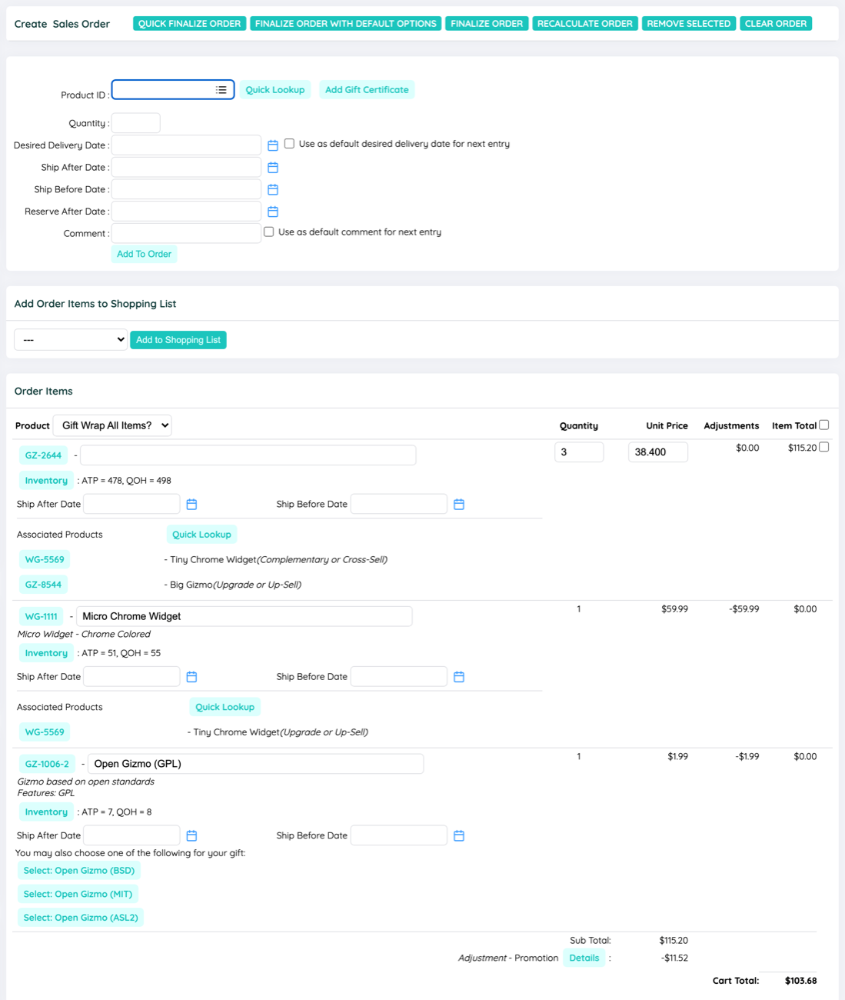
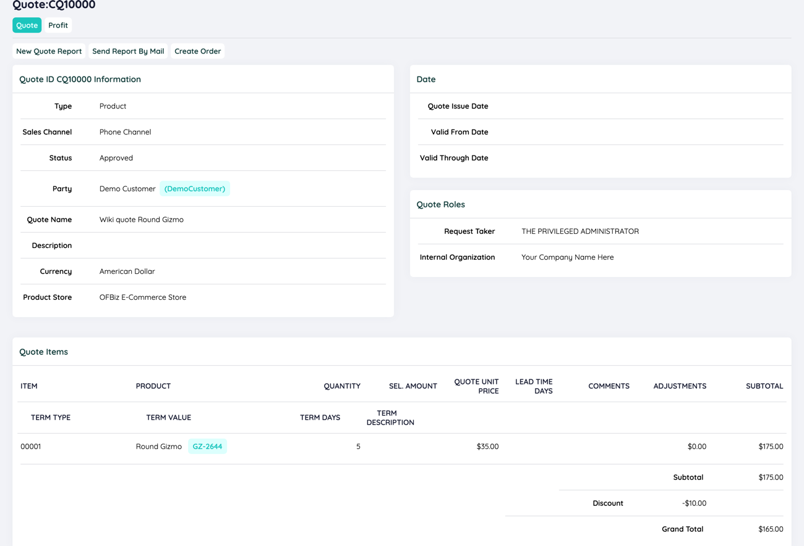
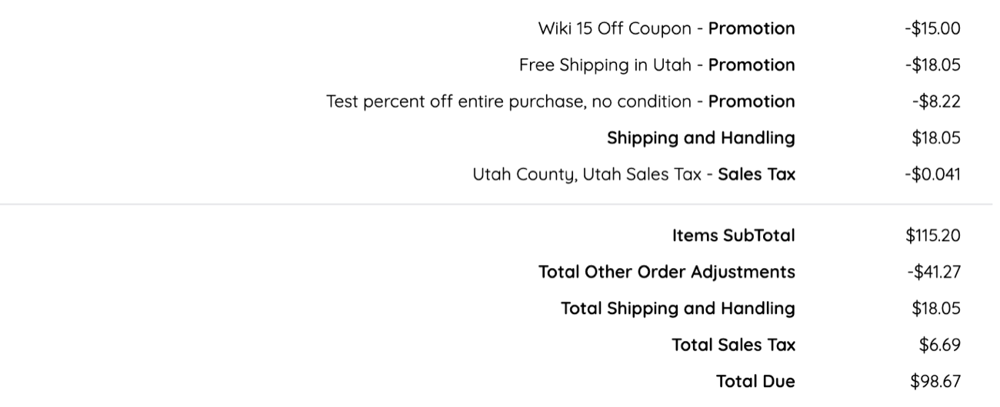
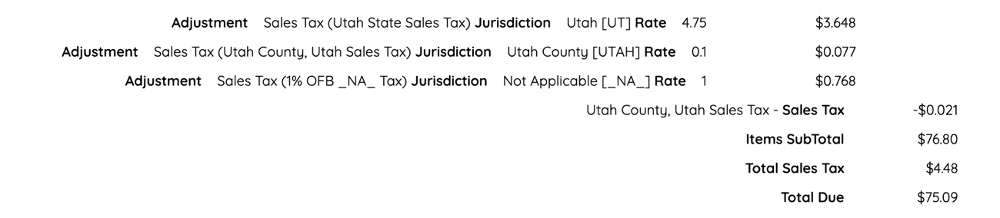

Apache OFBiz takes a sales order from the first quote to the invoice. It sets the price, reserves the stock, and sends the order to the warehouse. It is free and open source under the Apache License 2.0.

<h2 id="Ord1">Who it is for</h2>

<ul class="iconsList">
  <li><i class="icon-pin"></i> Sales and customer service teams who enter orders for customers, for example by phone.</li>
  <li><i class="icon-pin"></i> Businesses that sell through a web store and a back office at the same time.</li>
  <li><i class="icon-pin"></i> Teams that want orders, stock and accounting in one system.</li>
</ul>

<h2 id="Ord2">What OFBiz does for orders</h2>

<h3>Enter orders in the back office</h3>

Staff enter a sales order for a customer: the store, the items, the ship-to address, the shipping method and the payment. The order reserves stock as soon as it is created.
Guide: <a href="https://cwiki.apache.org/confluence/pages/viewpage.action?pageId=467436325">Create a Sales Order in the Back Office in Apache OFBiz</a>

<h3>Quotes that turn into orders</h3>

Build a quote with the customer's prices and discounts, and approve it. When the customer says yes, one click loads the quote into a sales order, with the quoted prices kept.
Guide: <a href="https://cwiki.apache.org/confluence/pages/viewpage.action?pageId=467436329">Create a Quote and Turn It into a Sales Order in Apache OFBiz</a>

<h3>Prices and price rules</h3>

Give each product a default price and a list price. Price rules then change the price for some products, customers or quantities, such as 10% off for 10 units or more.
Guide: <a href="https://cwiki.apache.org/confluence/pages/viewpage.action?pageId=467436332">Set Product Prices and Price Rules in Apache OFBiz</a>

<h3>Promotions and coupon codes</h3>

Set up promotions such as an amount off an order, free shipping or a free gift. A promotion can apply to every order, or only with a coupon code, with limits per customer and per code.
Guide: <a href="https://cwiki.apache.org/confluence/pages/viewpage.action?pageId=467436336">Set Up Promotions and Coupon Codes in Apache OFBiz</a>

<h3>Sales tax</h3>

Set up tax rates by country, state, county and postal code. OFBiz adds the right tax lines to each order, and leaves out customers who are tax exempt.
Guide: <a href="https://cwiki.apache.org/confluence/pages/viewpage.action?pageId=467436340">Set Up Sales Tax for Orders in Apache OFBiz</a>

<h3>Invoices and card payments</h3>

OFBiz creates the sales invoice when the order is packed. With a payment provider connected, a card is authorized when the order is placed. Trunk ships no provider connections, so a developer must add one.
Guide: <a href="https://cwiki.apache.org/confluence/pages/viewpage.action?pageId=467436343">Invoice and Capture Payment for a Sales Order in Apache OFBiz</a>

<h3>Change or cancel an order</h3>

Change quantities and prices, add items, or cancel one item or the whole order. OFBiz updates the stock reservations, and you can change any quantity that has not shipped.
Guide: <a href="https://cwiki.apache.org/confluence/pages/viewpage.action?pageId=467436347">Change or Cancel a Sales Order in Apache OFBiz</a>

<h3>Backorders</h3>

Accept orders for stock you do not have yet. OFBiz ships them when new stock arrives.
Guide: <a href="https://cwiki.apache.org/confluence/pages/viewpage.action?pageId=467436435">Backorders in Apache OFBiz: Selling When Stock Runs Out</a>

<h3>Subscriptions and repeat orders</h3>

Sell subscriptions that give a customer access for a set time, and renew them with a new order. In the online store, customers can also keep a shopping list that is ordered again on a schedule.
Guide: <a href="https://cwiki.apache.org/confluence/pages/viewpage.action?pageId=467436351">Set Up Recurring Orders and Subscriptions in Apache OFBiz</a>

<h3>Customer returns and refunds</h3>

Record a return, receive the items back into stock, and refund the customer.
Guide: <a href="https://cwiki.apache.org/confluence/pages/viewpage.action?pageId=467436300">Receive Customer Returns Back into Stock in Apache OFBiz</a>

<h3>Dropship</h3>

Sell products the supplier ships straight to your customer. OFBiz creates the purchase order for you.
Guide: <a href="https://cwiki.apache.org/confluence/pages/viewpage.action?pageId=467436306">Ship Directly from the Supplier to the Customer (Dropship) in Apache OFBiz</a>

 A sales order being entered, with items and stock.

 An approved quote, ready to become an order.

 Order totals with a coupon discount.

 The sales tax lines of an order.

<h2 id="Ord3">How it connects with the rest of OFBiz</h2>

Each order reserves stock in the warehouse, and the warehouse picks, packs and ships it. Invoices and payments go to accounting. See <a href="/warehouse-management/">Warehouse Management</a> and <a href="/inventory-management/">Inventory Management</a>.

<h2 id="Ord4">Try it</h2>

<ul class="iconsList">
  <li><i class="icon-pin"></i> Open the <a href="/ofbiz-demos/">public demo</a> and go to the Order application.</li>
  <li><i class="icon-pin"></i> <a href="/downloads/">Download Apache OFBiz</a> and run it on your own computer.</li>
  <li><i class="icon-pin"></i> Read all the order guides on the wiki: <a href="https://cwiki.apache.org/confluence/pages/viewpage.action?pageId=467436386">Apache OFBiz for Order Management</a>.</li>
</ul>

<h2 id="Ord5">Questions and answers</h2>

<h3>Is Apache OFBiz free?</h3>

Yes. It is open source under the Apache License 2.0. You can use it, change it and run it at no cost.

<h3>Can customers order online?</h3>

Yes, through the OFBiz online store. It is a plugin that you install separately, and its orders appear in the same Order application.

<h3>Can I change an order after it is approved?</h3>

Yes, until it ships. Quantities that have shipped cannot be changed.

<h3>Does it work out sales tax for me?</h3>

Yes, once you set up the tax rates for the places you ship to. OFBiz does not download tax rates for you.

<h3>Do I need technical skills to set it up?</h3>

Yes. OFBiz runs on Java, and setup needs some technical work. The <a href="https://cwiki.apache.org/confluence/display/OFBIZ/Apache+OFBiz+Service+Providers">service providers list</a> names people who can help.

<h2 id="Ord6">Get help</h2>

Ask questions on the <a href="/mailing-lists/">user mailing list</a>. See who uses OFBiz on the <a href="https://cwiki.apache.org/confluence/display/OFBIZ/Apache+OFBiz+User+List">user list</a>, and find help on the <a href="https://cwiki.apache.org/confluence/display/OFBIZ/Apache+OFBiz+Service+Providers">service providers list</a>.

