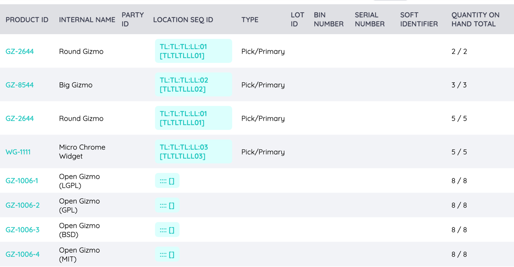
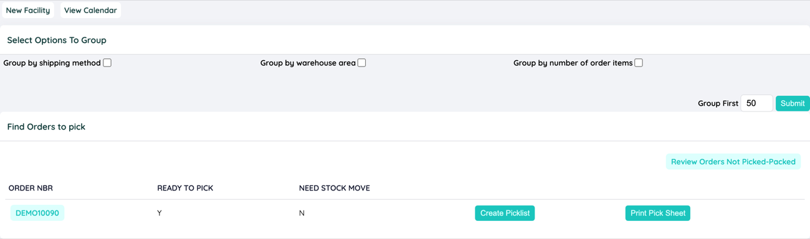
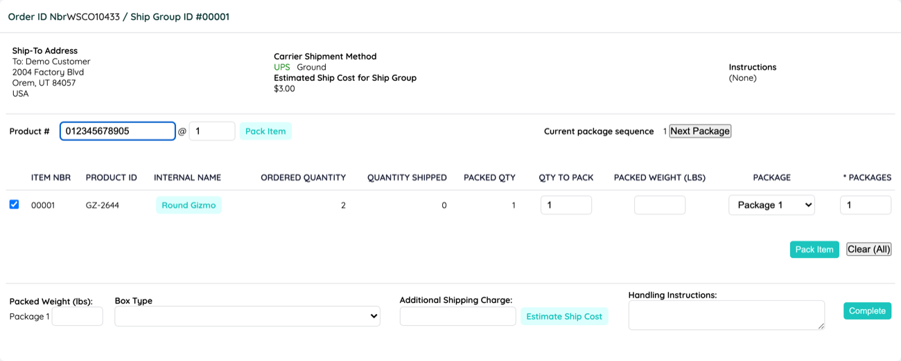
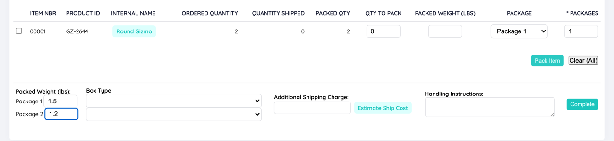

Apache OFBiz runs the daily work of a warehouse: receiving, putting away, picking, packing, shipping and counting stock. It is free and open source under the Apache License 2.0, and it shares one database with orders, purchasing and accounting.

<h2 id="WmsWho">Who it is for</h2>

<ul class="iconsList">
  <li><i class="icon-pin"></i> Businesses that run one or more of their own warehouses, such as distributors, manufacturers and online sellers.</li>
  <li><i class="icon-pin"></i> Warehouse managers who want every unit tracked by location.</li>
  <li><i class="icon-pin"></i> Teams that want warehouse work and orders in one system, and the freedom to change the software.</li>
</ul>

<h2 id="WmsFeatures">What OFBiz does in the warehouse</h2>

<h3>Warehouses, locations and bins</h3>

Set up each warehouse with its own locations, such as aisles, racks and bins. Every stock item belongs to a location, so staff always know where to find it.
Guide: <a href="https://cwiki.apache.org/confluence/pages/viewpage.action?pageId=467436219">Set Up Warehouses and Locations</a>

<h3>Receive and put away stock</h3>

Receive goods against a purchase order, or without one. Choose the location when you receive, or move the stock to its shelf later.
Guides: <a href="https://cwiki.apache.org/confluence/pages/viewpage.action?pageId=373887291">Receiving Items Against a Purchase Order</a>, <a href="https://cwiki.apache.org/confluence/pages/viewpage.action?pageId=467436223">Put Away Received Stock into Locations</a>

<h3>Pick, pack and ship orders</h3>

OFBiz shows which orders are ready to pick, and staff pick them with a picklist. Packers check each item on the packing screen and complete the shipment.
Guide: <a href="https://cwiki.apache.org/confluence/pages/viewpage.action?pageId=467436226">Pick, Pack and Ship an Order</a>

<h3>Packing slips</h3>

Print a packing slip for each box. It lists the items inside, so the customer can check them.
Guide: <a href="https://cwiki.apache.org/confluence/pages/viewpage.action?pageId=467436426">Print a Packing Slip</a>

<h3>Pack one order into several boxes</h3>

Put the items of one order into several boxes on the packing screen. Each box gets its own weight and its own package record.
Guide: <a href="https://cwiki.apache.org/confluence/pages/viewpage.action?pageId=467436297">Pack One Order into Several Boxes</a>

<h3>Barcodes and scanners</h3>

Print barcode labels for products, pick sheets and shipments. A normal USB or Bluetooth scanner works on the packing screen, and it accepts the maker's UPC or EAN code.
Guide: <a href="https://cwiki.apache.org/confluence/pages/viewpage.action?pageId=467436285">Print Barcodes and Use a Scanner in the Warehouse</a>

<h3>Package weights and tracking numbers</h3>

Enter the weight of each package when you pack. Record the carrier's tracking number on the shipment.
Guide: <a href="https://cwiki.apache.org/confluence/pages/viewpage.action?pageId=467436289">Weigh Packages and Record Tracking Numbers</a>

<h3>Move stock between warehouses</h3>

Send stock from one warehouse to another with an inventory transfer. Each transfer has a status, such as En-Route or Complete.
Guide: <a href="https://cwiki.apache.org/confluence/pages/viewpage.action?pageId=467436229">Move Stock Between Warehouses</a>

<h3>Count stock and fix quantities</h3>

Count stock on the shelf and record the difference with a reason, such as Damaged or Lost. OFBiz updates the quantity and the stock value in the books.
Guide: <a href="https://cwiki.apache.org/confluence/pages/viewpage.action?pageId=467436231">Count Stock and Adjust Quantities</a>

<h3>Receive customer returns</h3>

Receive returned items in the warehouse and put them back into stock. Each returned line becomes its own stock item, linked to the return.
Guide: <a href="https://cwiki.apache.org/confluence/pages/viewpage.action?pageId=467436300">Receive Customer Returns Back into Stock</a>

<h3>Hold damaged stock and return it to suppliers</h3>

Put damaged stock on hold so no order can take it. Send it back to the supplier on a return shipment, and OFBiz records what the supplier owes you.
Guides: <a href="https://cwiki.apache.org/confluence/pages/viewpage.action?pageId=467436303">Hold or Scrap Damaged Stock</a>, <a href="https://cwiki.apache.org/confluence/pages/viewpage.action?pageId=467436310">Return Stock to a Supplier</a>

<h2 id="WmsScreens">Screenshots</h2>

 Stock by location in a warehouse.

 Orders that are ready to pick.

 The packing screen after scanning a product's UPC.

 One order packed into two boxes, with a weight for each.

<h2 id="WmsConnects">How it connects with the rest of OFBiz</h2>

Sales orders reserve stock in the warehouse, and purchase orders tell the warehouse what to receive. Receipts and stock counts also post to accounting. For stock levels, reorder points and lots, see <a href="/inventory-management/">Inventory Management</a>.

<h2 id="WmsTry">Try it</h2>

<ul class="iconsList">
  <li><i class="icon-pin"></i> Open the <a href="/ofbiz-demos/">public demo</a> and go to the Facility application.</li>
  <li><i class="icon-pin"></i> <a href="/downloads/">Download Apache OFBiz</a> and run it on your own computer.</li>
  <li><i class="icon-pin"></i> Read all the warehouse guides on the wiki: <a href="https://cwiki.apache.org/confluence/pages/viewpage.action?pageId=467436385">Apache OFBiz for Inventory and Warehouse Management</a>.</li>
</ul>

<h2 id="WmsFaq">Questions and answers</h2>

<h3>Is Apache OFBiz free?</h3>

Yes. It is open source under the Apache License 2.0. You can use it, change it and run it at no cost.

<h3>Can it run several warehouses?</h3>

Yes. You can set up as many warehouses as you need, each with its own locations. A store can take stock from one warehouse or from several.

<h3>Does it work with barcode scanners?</h3>

Yes. Any scanner that types like a keyboard works. OFBiz has no separate scanner app.

<h3>Can it print carrier shipping labels?</h3>

Not today. OFBiz has no built-in connection to carriers such as UPS or FedEx. You print the label in the carrier's own tool, and record the tracking number in OFBiz.

<h3>Do I need technical skills to set it up?</h3>

Yes. OFBiz runs on Java, and setup needs some technical work. The <a href="https://cwiki.apache.org/confluence/display/OFBIZ/Apache+OFBiz+Service+Providers">service providers list</a> names people who can help.

<h2 id="WmsHelp">Get help</h2>

Ask questions on the <a href="/mailing-lists/">user mailing list</a>. See who uses OFBiz on the <a href="https://cwiki.apache.org/confluence/display/OFBIZ/Apache+OFBiz+User+List">user list</a>, and find help on the <a href="https://cwiki.apache.org/confluence/display/OFBIZ/Apache+OFBiz+Service+Providers">service providers list</a>.

